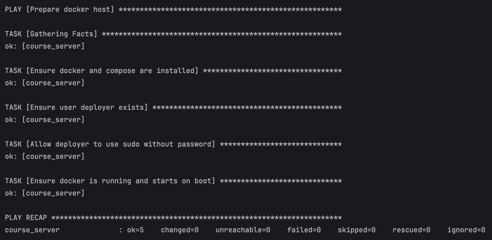
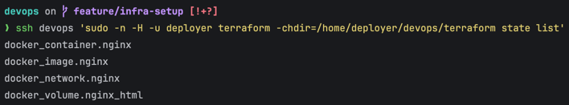
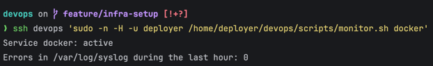
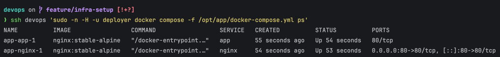
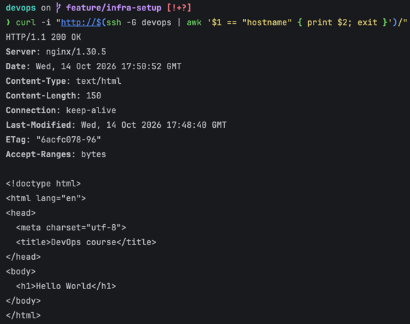

# DevOps hw1

## Структура

| Путь | Назначение |
| --- | --- |
| `ansible/` | создание `deployer`, установка и запуск `docker` & `compose` при загрузке |
| `terraform/` | Nginx с отдельной сетью, томом и портом `127.0.0.1:8081` |
| `scripts/monitor.sh` | мониторинг ошибок переданного сервера|
| `compose/` | Hello World и Nginx reverse proxy в отдельной сети |

Контейнер Terraform находится в сети `course_tf_nginx_net`. Оба контейнера Compose находятся в `course_compose_net`; запросы на порт 80 VM принимает `nginx` и передаёт сервису `app`. Эти две сети независимы.

## Развёртывание на VM

1. Клонируйте проект и дважды запустите Ansible. Второй запуск должен показать `changed=0` - идемпотентность:

   ```bash
   git clone https://github.com/deanonchikk/devops-course.git "$HOME/devops"
   cd "$HOME/devops/ansible"
   ansible-playbook -i inventory.ini setup_host.yml
   ansible-playbook -i inventory.ini setup_host.yml
   ```

2. Передайте проект `deployer` и войдите под ним:

   ```bash
   sudo install -d -o deployer -g deployer /home/deployer/devops
   sudo cp -a "$HOME/devops/." /home/deployer/devops/
   sudo chown -R deployer:deployer /home/deployer/devops
   sudo -iu deployer
   ```

3. Запустите Terraform через локальный Docker-сокет и проверьте Nginx:

   ```bash
   cd ~/devops/terraform
   export TF_VAR_docker_host=unix:///var/run/docker.sock
   terraform init
   terraform validate
   terraform plan
   terraform apply
   terraform state list
   curl -i http://127.0.0.1:8081/
   ```

4. Проверьте мониторинг docker, например:

   ```bash
   ~/devops/scripts/monitor.sh docker
   ```

5. Скопируйте файлы Compose в `/opt/app`, запустите контейнеры и проверьте ответ:

   ```bash
   sudo install -d -o deployer -g deployer /opt/app
   cp ~/devops/compose/{docker-compose.yml,nginx.conf,index.html} /opt/app/
   docker compose -f /opt/app/docker-compose.yml up -d
   docker compose -f /opt/app/docker-compose.yml ps
   curl -i http://127.0.0.1/
   ```

С другой тачки выполните `curl -i http://<VM_IP>/`. Ждем `200 OK` и страницу `Hello World`.

## Проверки для сдачи

Скриншоты результатов проверок:

1. Второй запуск `ansible-playbook -i inventory.ini setup_host.yml` с `changed=0`.

   

2. `terraform state list` с четырьмя ресурсами.

   

3. `~/devops/scripts/monitor.sh docker` со статусом сервиса и числом ошибок.

   

4. `docker compose -f /opt/app/docker-compose.yml ps` с двумя запущенными контейнерами.

   

5. `curl -i http://<VM_IP>/` с кодом `200 OK` и `Hello World`.

   

## Что пришлось исправить

Сначала я запускал Terraform на маке локально и через него управлял docker на тачке. Потом выяснил, что Terraform тоже нужно запускать на тачке. Я перенёс туда проект и подключил Terraform к локальному docker-сокету.

На тачке не получилось скачать Terraform с сайта HashiCorp, поэтому я взял его из официального docker-образа. Docker-провайдер тоже не скачивался обычным способом: я сохранил его в папке `.providers` и указал эту папку в `~/.terraformrc` пользователя `deployer`.
